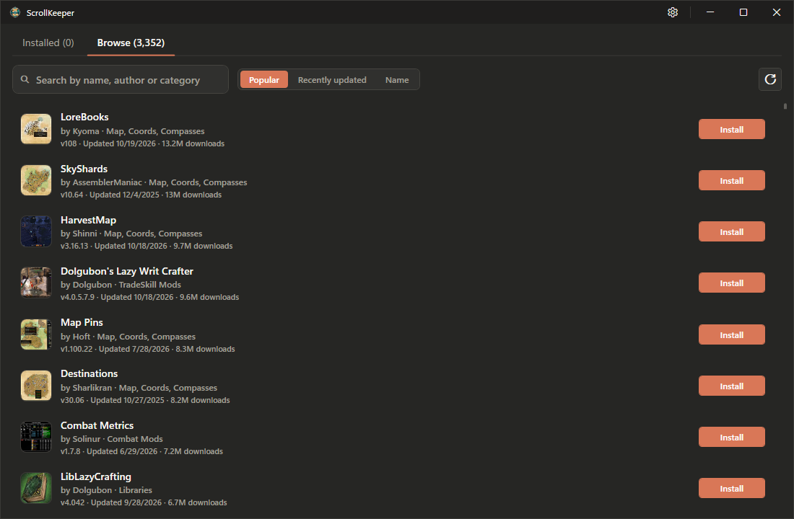
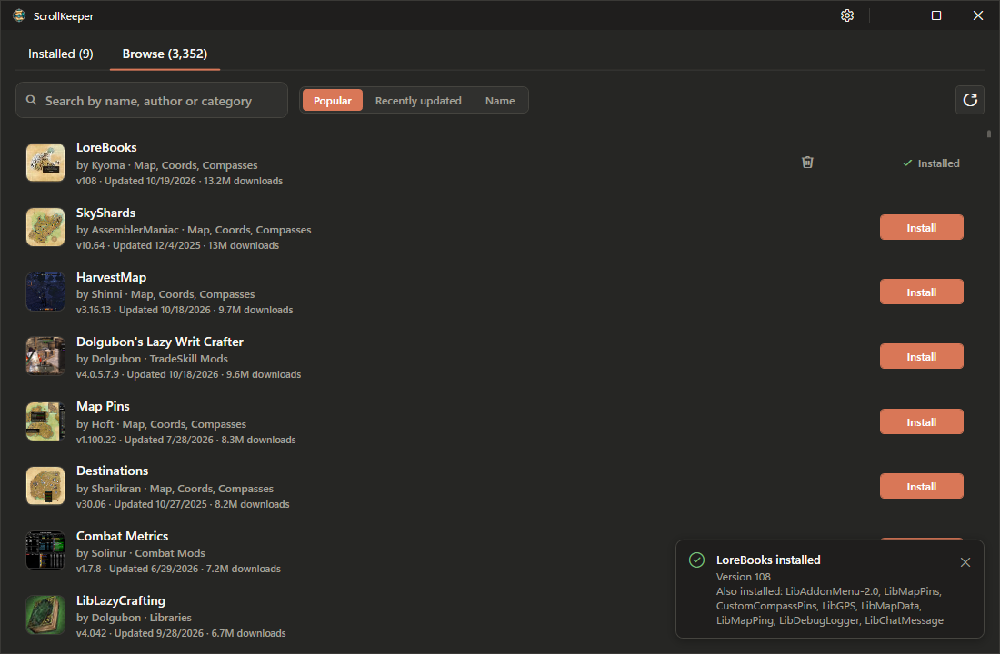
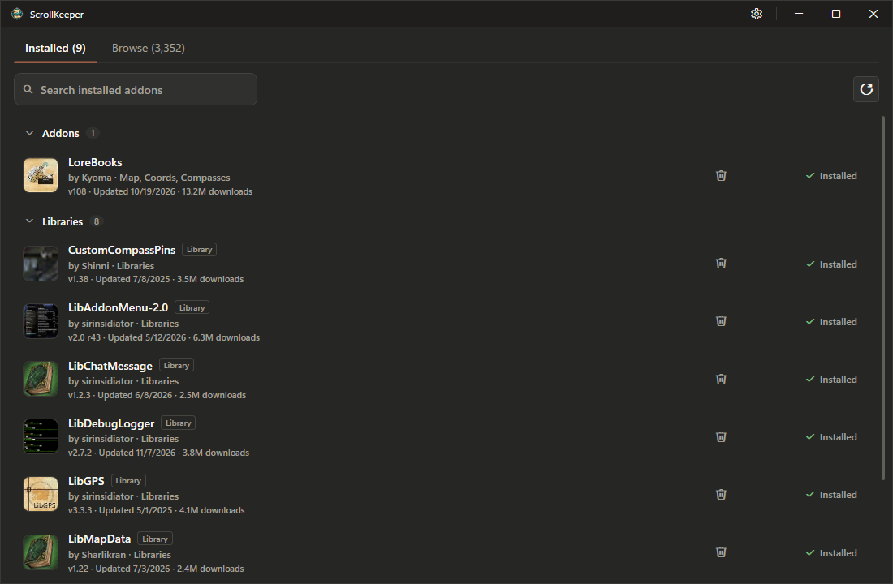
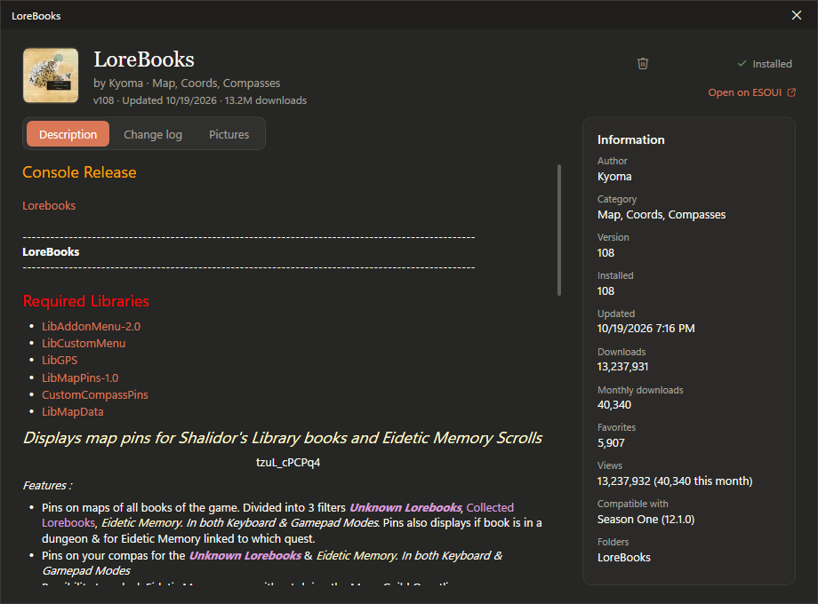
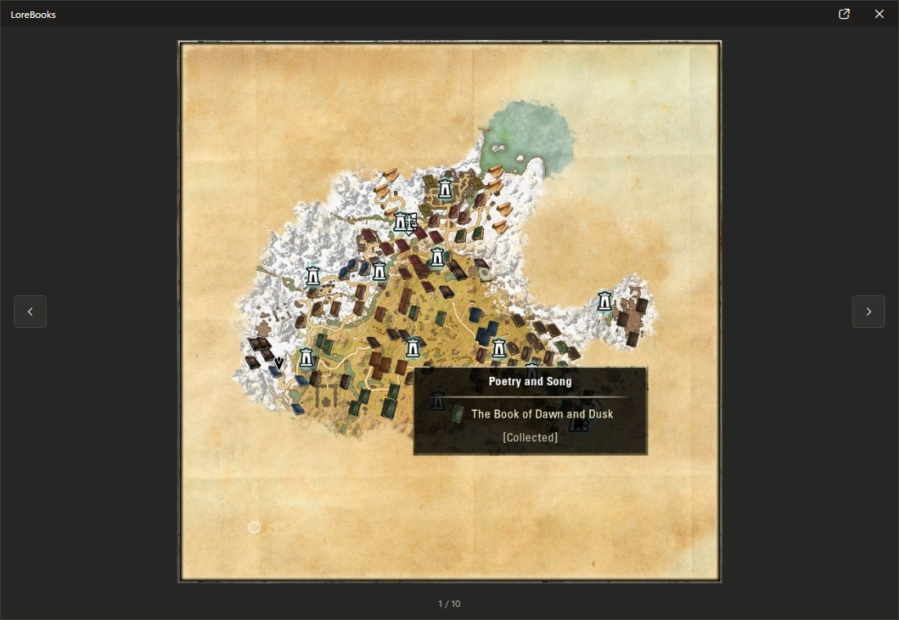
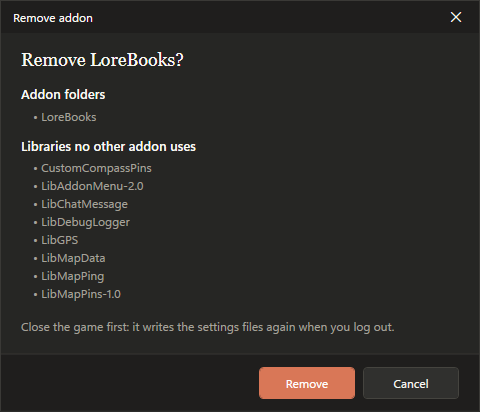

<div align="center">

# 📜 ScrollKeeper

### A modern addon manager for The Elder Scrolls Online

**Discover, install, and manage ESO addons and their libraries in one place.**

[](https://github.com/IgorBabayan/scroll-keepers)
[](https://www.elderscrollsonline.com/)
[](https://github.com/IgorBabayan/scroll-keepers/issues)

[**Releases**](https://github.com/IgorBabayan/scroll-keepers/releases) · [**Report a bug**](https://github.com/IgorBabayan/scroll-keepers/issues/new) · [**Request a feature**](https://github.com/IgorBabayan/scroll-keepers/issues/new)

</div>

---

## Overview

**ScrollKeeper** is a desktop addon manager for **The Elder Scrolls Online (ESO)**. It brings addon discovery, one-click installation, automatic handling of required libraries, and addon removal into a clean, dark-themed interface.

Browse the ESO addon catalog, inspect an addon's description and screenshots, and see exactly what is installed—all without managing individual addon folders by hand.

## Features

- 🔎 **Explore the addon catalog** — browse available addons and search by name, author, or category.
- ↕️ **Sort and discover** — order results by popularity, recent updates, or name.
- 📦 **One-click installation** — install addons directly from the Browse tab.
- 🧩 **Required library handling** — install the libraries needed by an addon alongside it, with a summary of what was added.
- 📚 **Organized installed list** — view addons and libraries in separate, collapsible sections.
- 📝 **Detailed addon information** — read descriptions, change logs, version details, author and category information, and download statistics.
- 🖼️ **Built-in picture viewer** — browse addon screenshots without leaving the application.
- 🗑️ **Dependency-aware removal** — see the addon folders being removed and libraries no other addon uses before confirming.
- 🔄 **Refresh controls** — reload the catalog or installed-addon view as needed.
- 🔗 **ESOUI integration** — open an addon's page on ESOUI directly from its details.
- 🌙 **Dark interface** — a focused desktop UI with clear install status and notifications.

## Screenshots

### Browse addons

Find addons with search and sorting controls, then install directly from the results.



### One-click installation with libraries

After installing an addon, ScrollKeeper shows confirmation and lists any libraries that were installed with it.



### Installed addons and libraries

See which addons are installed and which entries are shared libraries.



### Addon details

Read addon descriptions, inspect version and author information, view change logs, and open the original ESOUI page.



### Picture gallery

View full-size addon screenshots and navigate between pictures.



### Safe removal

Before removing an addon, review the folders that will be deleted and libraries that are no longer needed.



## Getting started

### 1. Download ScrollKeeper

Check the [GitHub Releases](https://github.com/IgorBabayan/scroll-keepers/releases) page for available builds and installation instructions.

### 2. Check your ESO addon location

Your ESO addons are typically stored in the following folder on Windows:

```text
Documents\Elder Scrolls Online\live\AddOns
```

The exact location may differ depending on your installation and Documents-folder configuration. Use the application's settings to check the configured location, if needed.

### 3. Browse and install

1. Open **ScrollKeeper** and select **Browse**.
2. Find an addon using the search field or browse the catalog.
3. Select an addon to see its details, description, change log, and pictures.
4. Click **Install**.
5. Review the success notification, including any required libraries added with the addon.

### 4. Manage your addons

Open **Installed** to see your addons and libraries. Use the refresh control to reload the list, or the remove icon to uninstall an addon.

> [!IMPORTANT]
> Close **The Elder Scrolls Online** before removing addons. The game can write addon settings when you log out, so changing addon files while it is running is not recommended.

## Dependency-aware removal

Some addons share libraries. When you request removal, ScrollKeeper distinguishes between the selected addon's folders and libraries that no other installed addon uses.

Review the confirmation dialog before proceeding, especially if you manually installed or modified addon folders.

## Frequently asked questions

**Does ScrollKeeper install required libraries?**  
Yes. When installing an addon with recognized requirements, ScrollKeeper can install the required libraries and show them in the installation notification.

**Where can I see installed libraries?**  
In the **Installed** tab, expand the **Libraries** section.

**Can I view the original addon page?**  
Yes. Open an addon's details and use **Open on ESOUI**.

**Where are ESO addons stored?**  
On a typical Windows installation, they are in `Documents\Elder Scrolls Online\live\AddOns`.

## Contributing and feedback

Bug reports, feature ideas, and pull requests are welcome.

- [Open an issue](https://github.com/IgorBabayan/scroll-keepers/issues)
- [Browse pull requests](https://github.com/IgorBabayan/scroll-keepers/pulls)

If you report a problem, include your Windows version, a description of what happened, and steps to reproduce it. Screenshots or error messages are helpful when available.

## Credits

- [ESOUI](https://www.esoui.com/) and the ESO addon authors and maintainers who make the addon ecosystem possible.
- The Elder Scrolls Online community.

## Disclaimer

ScrollKeeper is an **unofficial community project**. It is not affiliated with, endorsed by, or sponsored by ZeniMax Online Studios or Bethesda Softworks. **The Elder Scrolls Online** and related names are trademarks of their respective owners.
